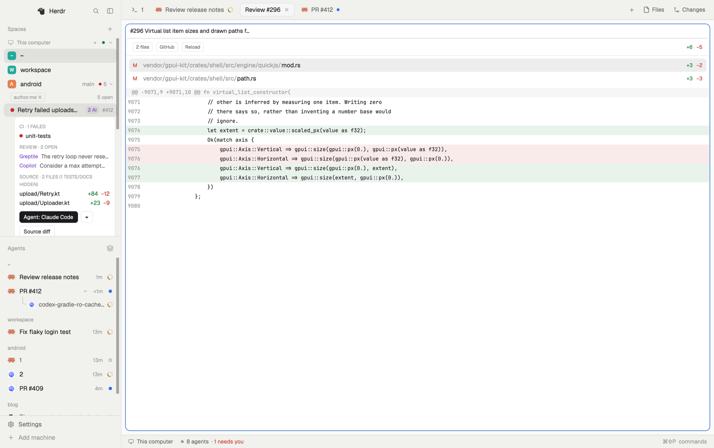
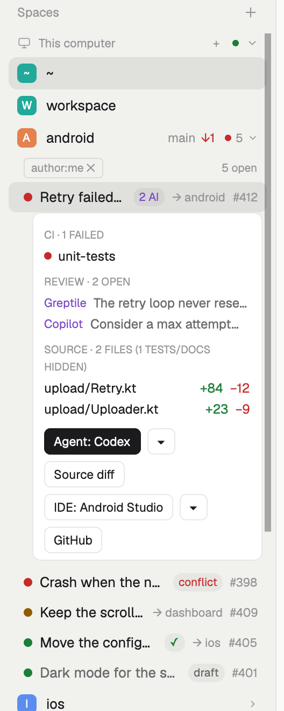
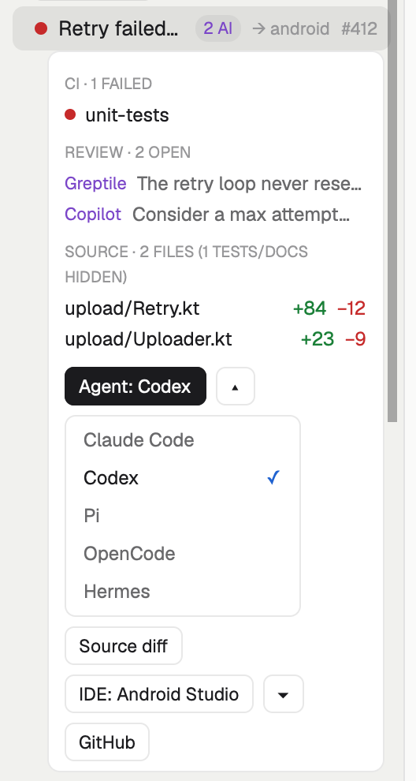
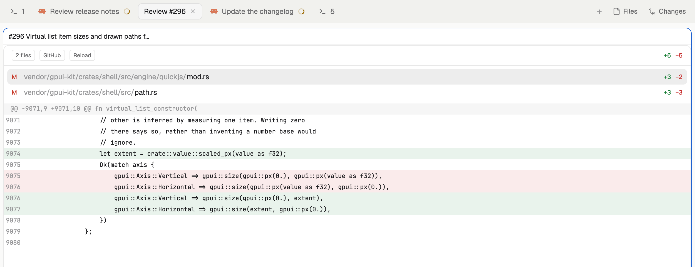
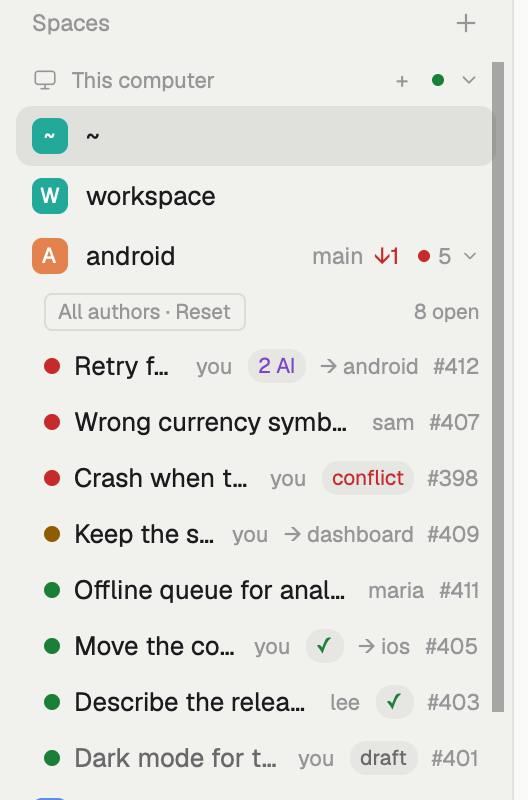
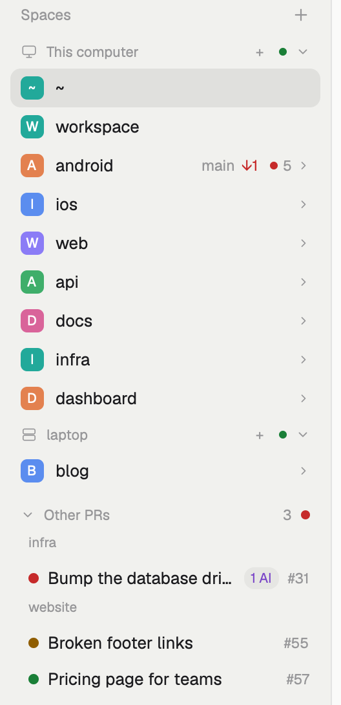
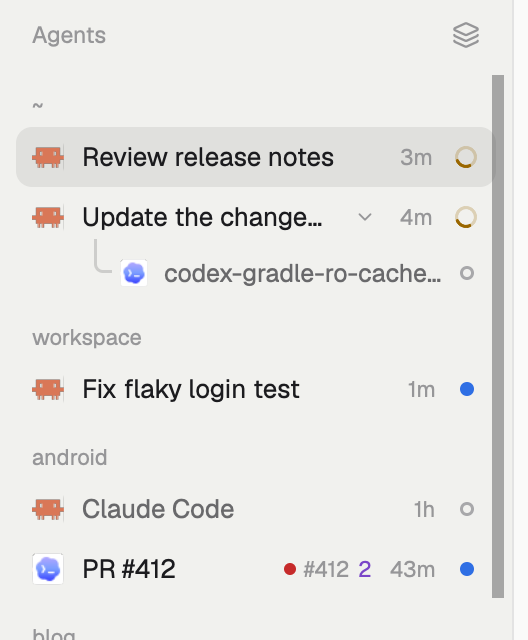

# PR Roundup

A [Herdr](https://herdr.dev) layout that puts your open pull requests under the space of their repository: CI state, AI review comments, a source-only diff pane, and one click to start an agent or an IDE in the PR's worktree. Made to follow your PRs, their CI, and the agents that work on them.

## Install

Ask your agent in Herdr: "add the layout github.com/kherembourg/herdr-pr-roundup". Or copy `layouts/pr-roundup.json` to `~/.config/herdr-app/layouts/` and the three folders in `mods/` to `~/.config/herdr-app/mods/`, then switch to it with `Ctrl+Shift+L`.

Needs the GitHub CLI, logged in (`gh auth login`).

**What it runs:** the mods call GitHub through `gh`, run `git` in your clones (and on your other machines for their spaces), create git worktrees when you ask for an agent or an IDE, and start the agent or IDE you pick.

## Features

### Your PRs under their space

Each space in a GitHub clone shows a CI dot and the number of your open PRs there. Click the space: its PRs open under it. Click it again to fold them. One space shows its PRs at a time.

Each PR row shows its CI dot, its title, and pills: `conflict`, `draft`, `✓` (approved), `N AI` (open review threads, AI reviewers marked), `→ space` (a pane is on its branch), and its number. The highest PR number comes first.

Click a PR to see its details card:

- **CI**: the failed checks, or the running ones.
- **Review**: the open review threads, with the reviewer and the first line of the comment.
- **Source**: the changed files, without tests and docs.
- One button per row: **Agent**, **Source diff**, **IDE** and **GitHub**.

 

### Start an agent on the PR

**Agent** starts your default agent in a new tab `PR #n`, in a worktree on the PR's branch. Its first message gives the PR's link and branch and asks it to read the CI and the open comments, summarize them, and wait for your instructions.

`▾` opens the installed agents right under the button. Your pick starts and becomes the one-click default.

The worktree goes to `<clone>/.worktrees/` when your repository ignores that folder, else to `~/.herdr/worktrees/<repo>/`. An existing worktree on the branch is used again.

 

### Review the source diff

**Source diff** opens the PR's diff in a pane beside yours, titled with the PR's number and title. Tests, docs and markdown stay hidden until you ask for them. Click a file to see its diff.

### Review in your IDE

**IDE** opens the PR's worktree in your default IDE, with a review view:

- **Zed**: one side-by-side diff tab per changed source file.
- **VS Code**, **Cursor** and **Windsurf**: the worktree in a new window, then one diff tab per changed source file.
- **IntelliJ IDEA** and **Android Studio**: the worktree. Their GitHub plugin offers the pull request review mode for the checked-out branch.
- **Xcode**: the worktree.

The right side of each diff is the real worktree file, so you can edit it there. `▾` picks another installed IDE and makes it the default.

### Every author's PRs

The list starts with your PRs (`author:me ✕`). Click the chip to see the open PRs of every author in that repository, each with its author. `Reset` goes back to yours. Each space keeps its own filter.

 

### Other PRs

Your PRs in repositories that no space is in go to **Other PRs**, at the end of the list, under the name of their repository. The group is folded, with its count and its worst CI dot.

 

### PRs on agent rows

In the agents list, an agent whose pane is on a PR's branch shows the PR's CI dot, its number, and the number of open review threads. Hover it for the repository and the CI state. Click it to open the PR on GitHub.

 

## More

- Your PRs refresh every 2 minutes.
- A space on another machine gets the PRs of its repository there.
- How it is built, and how to rebuild it: [RECIPE.md](RECIPE.md).

## License

Apache-2.0, as Herdr. `mods/pr-roundup-spaces`, `mods/pr-roundup-agents` and `mods/pr-roundup-pane` are modified copies of Herdr's `spaces`, `agents` and `pane` mods (Herdr 0.1.11, [herdrdev/herdr-app](https://github.com/herdrdev/herdr-app)); the changes add the PR lists, the diff pane, the PR on agent rows and the diff pane titles.
