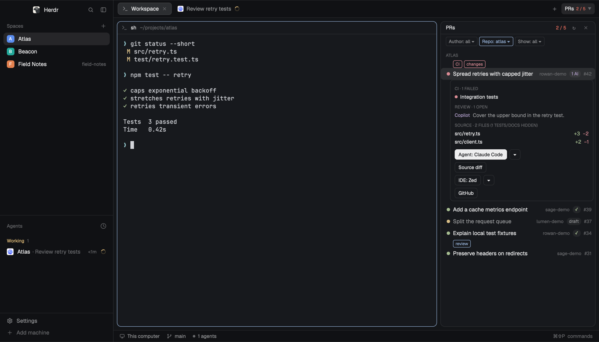
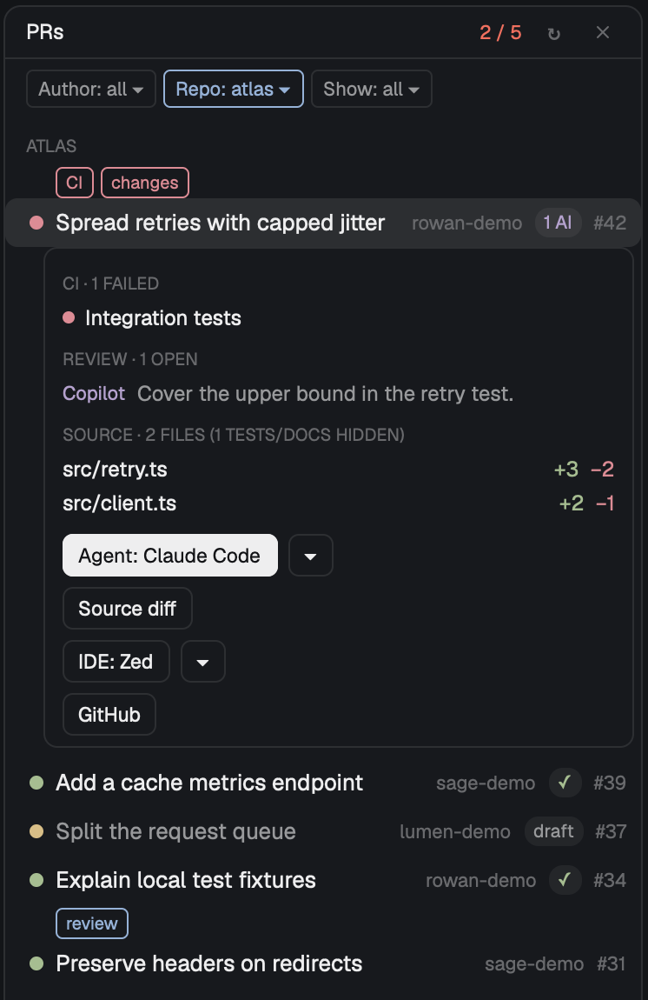
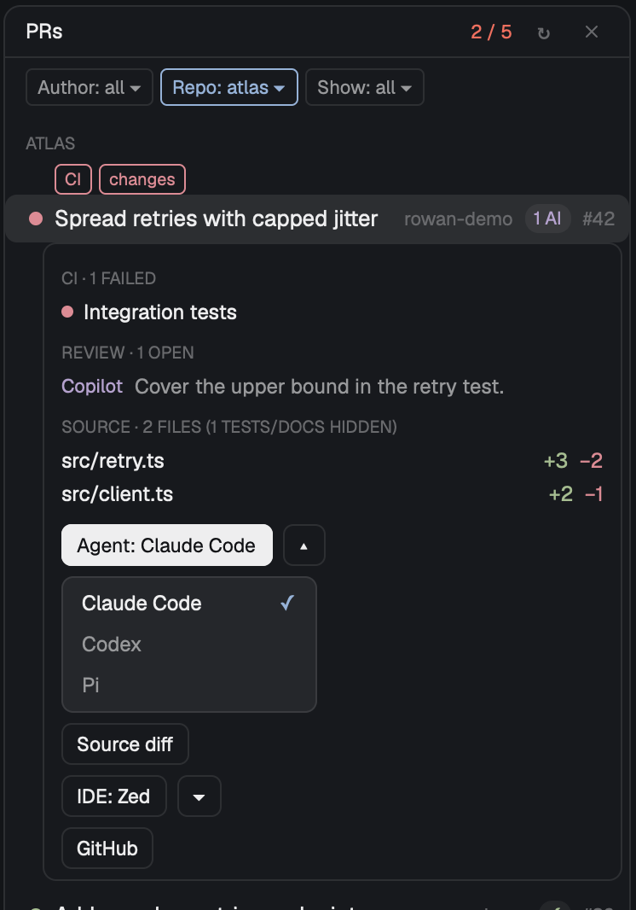
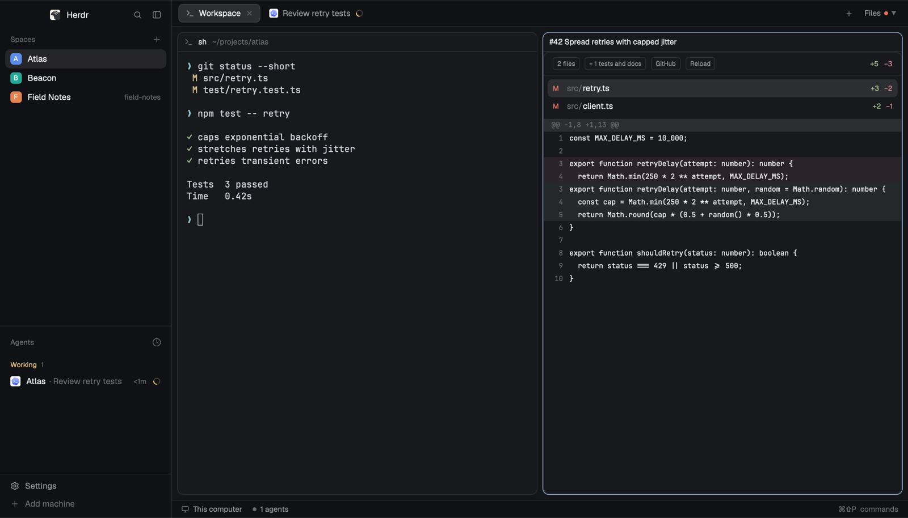

# PR Roundup

A [Herdr](https://herdr.dev) layout that shows GitHub pull requests in a right-hand panel for the active space. Review CI, open comments and changed files, then open a source diff or start an agent in the PR’s worktree.



Screenshots use fictional projects and pull requests.

## Install

Ask your agent in Herdr: "add the layout github.com/kherembourg/herdr-pr-roundup". Or copy `layouts/pr-roundup.json` to `~/.config/herdr-app/layouts/` and the folders in `mods/` to `~/.config/herdr-app/mods/`, then switch to it with `Ctrl+Shift+L`.

To update an existing installation, copy the current layout and mods over your installed copies.

Needs the GitHub CLI, logged in (`gh auth login`).

The panel sections need more tools:

- **Cost**: `bun` and `python3`.
- **Linear**: `jq` and `curl`, and a Linear API key (see [Linear](#linear)).

**What it runs:** the mods call GitHub through `gh`, call the Linear API through `curl`, read your usage through `bunx ccusage@latest`, run `git` in your clones (and on your other machines for their spaces), create git worktrees when you ask for an agent or an IDE, and start the agent or IDE you pick.

## Features

### PRs panel



Choose **PRs** from the top-right panel menu. The panel starts with the active space’s GitHub repository and follows the space when you switch. It checks live terminal folders for a GitHub remote before trying the space’s saved folder. If no repository is found, the panel shows your open PRs and review requests.

Three filters narrow the list:

- **Author** shows all authors in the selected repository, your PRs, reviews requested from you, or one login.
- **Repo** switches to another repository or shows your open PRs and review requests across repositories.
- **Show** limits the view to PRs that need action.

Each row shows its CI status, title, and relevant markers for drafts, conflicts, approval, or open review threads. The badge counts PRs that need action and the total shown. Click a row to load review comments and changed source files, view its CI checks, or open the **Agent**, **Source diff**, **IDE**, and **GitHub** actions.

The panel caches PR summaries for five minutes and polls only while open. Use **Refresh PRs** (↻) to refresh sooner. If the GraphQL quota runs out, the panel uses REST until the reported reset. Open a PR to see its checks and files while using REST. Review thread status and comments resume when GraphQL is available.

<br clear="right">

### Start an agent on the PR



**Agent** starts your default agent in a new tab `PR #n` in a worktree on the PR’s branch. It uses the active space if its live checkout matches the PR’s repository, or looks for another space with that repository. The worktree is on the destination space’s machine. If no space matches, open one for the repository and try again.

The first message gives the agent the PR link and asks it to rebase, resolve conflicts, push, monitor CI, and address open review comments.

`▾` opens the installed agents right under the button. Your pick starts and becomes the one-click default.

The worktree goes to `<clone>/.worktrees/` when your repository ignores that folder, else to `~/.herdr/worktrees/<repo>/`. An existing worktree on the branch is used again.

<br clear="right">

### Review the source diff



**Source diff** opens the PR's diff in a pane beside yours, titled with the PR's number and title. Tests, docs and markdown stay hidden until you ask for them. Click a file to see its diff.

### Review in your IDE

**IDE** opens the PR's worktree in your default IDE, with a review view:

- **Zed**: one side-by-side diff tab per changed source file.
- **VS Code**, **Cursor** and **Windsurf**: the worktree in a new window, then one diff tab per changed source file.
- **IntelliJ IDEA** and **Android Studio**: the worktree. Their GitHub plugin offers the pull request review mode for the checked-out branch.
- **Xcode**: the worktree.

The right side of each diff is the real worktree file, so you can edit it there. `▾` picks another installed IDE and makes it the default.

### The panel menu

The top bar has one dropdown button at the right, in place of the Files and Changes buttons. Its name is the open panel section with its badge, for example `PRs 3 / 12 ▼`. When no section is open, it shows `Files`. A small red dot shows when another section has a warning.

Click the button to open the menu: **Files**, **Changes**, **Cost**, **PRs** and **Linear**, each with its badge. `↑` and `↓` move, `Enter` opens, `Esc` closes. A pick shows that section in the right panel. The `✕` at the right of each section's header closes the panel.

**Linear** shows only when a Linear tool is installed:

- the `linear` CLI is on the `PATH`,
- the Linear plugin of Claude Code is installed,
- a Linear MCP server is set in Codex, or
- `claude mcp get linear` succeeds.

Without a Linear tool, the menu hides Linear.

### Cost

The **Cost** section reads your Claude Code, Codex and pi usage through `bunx ccusage@latest`. It shows:

- today's cost, its trend against the 7-day average, and the cost of yesterday and of the month;
- a bar split by agent (Claude, Codex, pi);
- the current 5 hour block: its cost, the burn per hour, the projection and the time left;
- a 14-day bar chart, stacked by agent. Hover a bar for its numbers;
- the models of today;
- the cost by project: the Claude cost of today, plus the full cost of the Codex sessions active today;
- the top sessions of today. Click a session to focus its agent when a live pane has the same title.

The badge is today's cost. The section refreshes every 60 seconds.

### Linear

The **Linear** section lists the started issues (In Progress and In Review) of the teams you are a member of, grouped by state. Click an issue to open it in Linear. Three filter chips narrow the list: **Assignee** (`me` at first), **Project** and **Initiative**. Each chip value shows its count.

The section needs a Linear personal API key. Set the environment variable `LINEAR_API_KEY`, or add the key to the macOS keychain:

```sh
security add-generic-password -a "$USER" -s herdr-linear -w
```

Without a key, the section shows this setup line. To keep one team only, put its team key (such as `ENG`) in a file `mods/pr-roundup-ops/sources/linear-team`.

The badge is the number of issues after the filters. The section refreshes every 5 minutes.

## Implementation

See [RECIPE.md](RECIPE.md) for the layout structure and how to verify changes.

## License

Apache-2.0, as Herdr. The pane, tabs, files, and changes mods are modified copies of the corresponding [Herdr mods](https://github.com/herdrdev/herdr-app). The Spaces and Agents lists use Herdr’s built-in mods.
