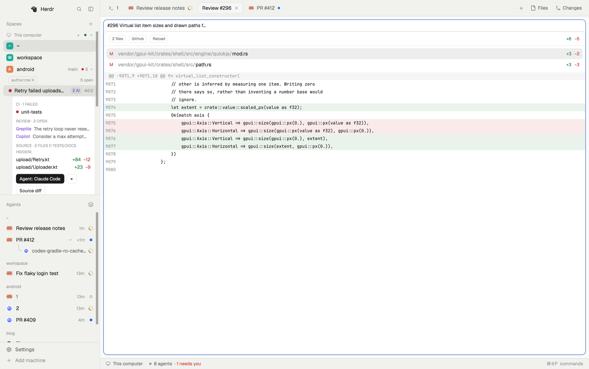

# PR Roundup

Herdr's default window, with your pull requests where you work. Each space shows the open PRs of its repository under it: CI state, open review threads (AI reviewers marked), and the changed source files. From a PR you start an agent in its worktree, open the source-only diff in a pane, open the worktree in an IDE, or go to the PR on GitHub. PRs of repositories that no space is in wait in a folded "Other PRs" group. Made to follow your PRs, their CI, and the agents that work on them.

## What you see

- **Left sidebar**, 268px (44–480px), theme `chrome` background: the 46px brand row (Herdr's `workspace-chrome`), then **Spaces** and **Agents** sharing the height 2:1 (each at least 90px), then the 69px footer (Settings, Add machine).
- **Spaces** is Herdr's spaces list (colored 18px letter avatars, worktrees nested under their checkout, machine headers, branch and ahead/behind after the name), plus:
  - On each space whose repository is on GitHub, at the right of its row: a 6px dot with the worst CI state of your PRs there (red failed, amber running, green passed, dim none), their count in 11px dim text, and a 10px chevron (right: closed, down: open).
  - Under the open space, a 26px filter line: a chip `author:me ✕` (or `All authors · Reset` without the filter), and at the right the number of open PRs (`5 open`) or a spinner while loading. Then one 28px row per PR, indented 14px: an 8px CI dot, the title (the conventional-commit prefix and a trailing `(ABC-123)` ticket removed; muted when draft), the author's login in all-authors mode, pills `draft`, `conflict` (red), `N AI` or `N` (open review threads, violet), `✓` (approved, green), `→ <space>` when a pane is on the PR's branch, and `#number`.
  - A clicked PR opens its details card below it (left margin 22px, 8px radius, theme `background`): **CI** (the failed checks, or up to 4 running, or "All checks passed"), **Review** (up to 3 open threads: reviewer, then the first line of the comment), **Source** (up to 6 changed files outside tests and docs, with +/−), then one button per row: `Agent: <name>` (solid) with a `▾`, `Source diff`, `IDE: <name>` with a `▾`, and the host's name (`GitHub`). A `▾` opens its choices right below its button, as a small menu (theme `popover`, 1px border, 7px radius, 24px text rows, hover highlight); the current default has an accent ✓.
  - At the end of the list, **Other PRs** (26px header, chevron, count, worst-CI dot), folded: your PRs in repositories no space is in, under a small label per repository (the owner's name removed from its start).
  - If GitHub can't be read, the error shows in red after "Spaces".
- **Agents**: Herdr's agents list, plus, on an agent whose pane is on a PR's branch, before its time: a 6px CI dot, `#number` in 11px dim text, and the count of open review threads in violet when there are some. Hovering it gives the repository, the CI state and the comment count. Clicking it opens the PR on GitHub (`cx.open_url`); the rest of the row still focuses the pane.
- **Tabs** (42px): Herdr's `tabs`, except that Files and Changes are not separate buttons. At the right, one dropdown button (26px) shows the open panel section and its badge (`PRs 3 / 12 ▼`), else `Files`. A 6px red dot shows when another section has a warning.
- The **tab's panes** as cards (10px radius, 8px gaps, 1px border, accent border when focused, framed even when alone), the right **panel** (hidden, 368px, 280–900px), and the status bar (28px): Herdr's own.
- **The panel menu** (popup, 200px): one 31px row per section (Files, Changes, Cost, PRs, Linear), each with its badge at the right and an accent dot on the open one. Linear is hidden when no Linear tool is installed.
- **Panel sections** (mod `pr-roundup-ops`), after Files and Changes:
  - **Cost**: today's cost in 30px text, its trend against the 7-day average, yesterday and month; a bar split by agent; the 5 hour block (cost, burn per hour, projection, time left, a bar of the time used); a 14-day chart of bars stacked by agent (tooltip on hover); models today; by project; top sessions of today (8 at most).
  - **PRs**: filter chips `Author`, `Repo`, `Show` (a click opens the values, with counts, under the chips), then the PRs grouped by repository (small caps label, highest number first). Over a row, tags `CI`, `changes` or `review`. Each row is the sidebar's PR row, with the same details card and buttons.
  - **Linear**: filter chips `Assignee`, `Project`, `Initiative` (counts in the values), then the issues grouped under a header per state (`In Progress · 4`): identifier, title, and the assignee's first name when the assignee filter is off. A click opens the issue.
- **Pane header** (30px, always shown): Herdr's `pane` header, except that a PR diff pane shows `#1878 <title>` instead of the mod's name.
- **The diff pane** (`Source diff`): a 36px bar with chips `N files`, `+ N tests and docs` / `Hide tests and docs`, `IDE: <name>` with a `▾` (its choices in the same small menu, below the bar), `GitHub`, `Reload`, and the +/− totals at the right; then the files (28px rows, status letter A/M/D, folder dim, name, +/−; at most 200px high) and the picked file's diff with line numbers, added lines on a green tint and removed ones on a red tint, as in Herdr's Changes panel.

## How it behaves

- **Click a space**: Herdr selects it and its PRs open under it; only one space shows its PRs at a time. Click the shown space again to fold them. Keys that change the space don't open lists.
- **A space's repository** is where its first terminal is now (its live folder), on its machine, read with `git remote get-url origin`. Each GitHub repository's PRs go under the first space in it; worktree spaces nested under it don't repeat them.
- **The filter**: `author:me ✕` shows every author's open PRs in that repository, each with its author; `All authors · Reset` goes back. Kept per space.
- **Order**: highest PR number first (newest PR at the top). The order does not change on a push or a comment.
- **CI** is judged from the newest run of each check on the last commit (GitHub's own rollup keeps old cancelled runs). Review threads count when not resolved and not outdated. Copilot, Greptile, CodeRabbit, Codex and Gemini count as AI reviewers.
- **Agent: <name>**: finds the worktree already on the PR's branch, or adds one (`<clone>/.worktrees/<ticket or branch>` when the repo ignores `.worktrees/`, else `~/.herdr/worktrees/<repo>/…`, `-pr<number>` added when taken), then opens a tab `PR #<number>` in the PR's space running that agent there, with a first message: the PR's link and branch, rebase on the PR's base branch, resolve conflicts and push (`--force-with-lease`), monitor the CI and fix failures, fix or push back on each open review comment, then push. Without a local clone it starts where the space is and asks the agent to make the worktree. The button reads `Starting…` meanwhile; a failure shows a notification.
- **IDE: <name>**: the same worktree, opened with that IDE's command. Zed, VS Code, Cursor and Windsurf also get one side-by-side diff tab per changed source file (at most 40): `zed --diff <base copy> <worktree file> … <worktree>`; for VS Code and its forks `code -n <worktree>`, then `code -r --diff <base copy> <worktree file>` once per file (it takes one diff per call), the base copies being the files at the merge base with the PR's base branch, written to `~/.herdr/pr-review/<repo>-<number>/` (an added file gets an empty one). The right side is the real worktree file, so edits there are saved to the worktree. JetBrains IDEs open the worktree, where their GitHub plugin offers the review mode of the checked-out branch's PR; no command line opens that mode directly. The IDEs offered are the installed ones among Zed (`zed`), Cursor (`cursor`), VS Code (`code`), Windsurf (`windsurf`), IntelliJ IDEA (`idea`), Android Studio (`studio`) and Xcode (`xed`, only with Xcode.app).
- **▾**: a pick in the menu runs that agent or IDE and makes it the one-click default, for the sidebar and every diff pane alike. The first default agent is Claude, else the first installed.
- **Source diff**: opens the diff pane to the right of the focused pane. Tests, docs and markdown are hidden until asked for. Click a file to see its diff.
- **The host button** opens the PR in the browser; it's named after the PR's host (GitHub, GitLab, Bitbucket, else the domain).
- **The panel button** opens the menu. A pick in the menu runs `layout.select` on the `panel-body` stack and `layout.show` on the `panel`. `↑`/`↓` move, `Enter` picks, `Esc` closes. The button's badge is the one the open section wrote. The side panel stays remembered per space, as in Herdr's `tabs`.
- **Linear is optional**: at start, `pr-roundup-tabs` runs one shell test (`linear` on the `PATH`; `"linear@"` in `~/.claude/plugins/installed_plugins.json`; `[mcp_servers.linear` in `~/.codex/config.toml`; `claude mcp get linear`). When none succeeds, the menu and the button hide Linear.
- **Cost**: `sources/cost.py` runs `bunx ccusage@latest` (offline prices) for the daily totals by agent, the active 5 hour block, and the sessions of today, and prints one JSON object. The Claude cost by project is today only. The Codex cost by project is the full cost of each session active today. A click on a top session focuses the agent when a live pane has the same title. Refresh every 60 seconds. Badge: today's cost.
- **PRs section**: your PRs (`author:@me`) and the reviews asked of you (`review-requested:@me`); with a repo picked, `repo:owner/name` adds all its open PRs. The repo list holds the local clones (found from the spaces' folders and their parent folders) and the repos of the loaded PRs. A PR needs action when it has a review request, a failed CI, requested changes, a conflict or open threads (a draft only with a review request). Refresh every 2 minutes. Badge: `needs action / total`, or the count when `Show` is `needs action`; it is a warning when some PR needs action.
- **Linear section**: `sources/linear.sh` asks the Linear GraphQL API through `curl` for the started issues (state type `started`, 250 at most) of the teams you are a member of, with assignee, project and initiatives. Refresh every 5 minutes. Badge: the number of issues after the filters. The key is `LINEAR_API_KEY`, else the macOS keychain item `herdr-linear`; without a key the script exits with code 2 and the section shows the setup line. A file `sources/linear-team` with one team key keeps that team only.
- **Refresh**: your PRs every 2 minutes, and an every-author list while it shows; the `N open` text refreshes now.
- **Agent status** (working, blocked, done, idle) shows as in Herdr: the agents list, the tab dots, and the pane header's spinner, "Needs you" badge and dot.
- A narrow sidebar (< 160px) shows Herdr's compact rail, without PRs.

## Built from

- `layouts/pr-roundup.json`: a clone of Herdr's `main` layout (0.1.11). Tree: `root` row → `sidebar` column (`brand` block `workspace-chrome`; `sidebar-lists` column with `spaces` block `pr-roundup-spaces` weight 2 and `agents` block `pr-roundup-agents` weight 1; `sidebar-footer` block `workspace-chrome {footer: true}`) and `work` column (`tabs` block `pr-roundup-tabs`; `work-body` row with `main` block `{tab: "active"}` and the hidden `panel` stack (`panel-body`) of `files`, `changes` and the blocks `cost`, `prs` and `linear`, each `pr-roundup-ops {section: "cost" | "prs" | "linear"}`; `status` block `workspace-status`). The `main` block's pane header is `{content: {mod: "pr-roundup-pane"}, height: 30, position: "top", reveal: "always"}`, `lone: true`.
- `mods/pr-roundup-spaces/` (a clone of Herdr's `spaces` 0.1.11):
  - `main.js`: the spaces list; the git look that gives each space its repository also runs `git remote get-url origin` (with `exec(..., { on: machine })`). Holds the PR lists, the filter, Other PRs, and finds local clones (the repos of the spaces, then the folders beside them). Opened with `props.diff` it is the diff pane instead.
  - `prs.js`: one GraphQL query through `gh api graphql` (`search(query: "<author:@me | repo:owner/name> is:pr is:open archived:false", first: 100)` with checks, review threads and files), the CI and thread rules, the rows, the details card, the Agent button (`knownAgents()`, `run("tab.new", {name, space, folder, argv, task})`).
  - `diff.js`: `gh pr diff <n> -R owner/name --color=never`, parsed per file; the worktree lookup and creation (`git worktree list --porcelain`, `git fetch`, `git worktree add`); the IDE list and launch; the diff pane, opened with `run("pane.split", {direction: "right", mod: "pr-roundup-spaces", props: {diff: {...}}})`.
- `mods/pr-roundup-agents/` (a clone of Herdr's `agents` 0.1.11): reads shared `prs.branches` (branch → `{number, repo, url, ci, threads}`, written by `pr-roundup-spaces` from the PRs it fetched, only when it changes) and the agent's pane branch from `panes()`.
- `mods/pr-roundup-pane/` (a clone of Herdr's `pane`): reads `shared("pane.titles")[pane]` for mod panes.
- `mods/pr-roundup-tabs/` (a clone of Herdr's `tabs` 0.1.12): the panel dropdown replaces the Files and Changes buttons. It reads shared `ops.badge.<id>` ({text, warn}) and writes shared `ops.linear` (a bool, from the Linear test). The section list is `OPS` in `main.js`.
- `mods/pr-roundup-menu/`: the popup of the dropdown. It reads `ops.linear` and `ops.badge.<id>`, and runs `layout.select` and `layout.show`. Its `OPS` list is a copy of the one in `pr-roundup-tabs`: keep both in sync.
- `mods/pr-roundup-ops/`: one block per section, with props `{section}`. It writes shared `ops.badge.<id>` ({text, warn}) after each refresh, and keeps the filters in shared `ops.prs.filter` and `ops.linear.filter`. Files: `main.js` (the three sections), `filter.js` (the rules for "needs action"), `prs.js` and `diff.js` (the PR rows, details card and buttons), `sources/cost.py`, `sources/linear.sh`. `prs.js` and `diff.js` are copies of the ones in `pr-roundup-spaces` (a mod cannot import from another): keep them in sync.
- State: shared `prs.agent`, `prs.ide` (the defaults), `prs.branches` (for the agents list) and `pane.titles` (diff pane titles), `ops.badge.<id>`, `ops.linear`, `ops.prs.filter`, `ops.linear.filter`, `ops.collapsed`; per copy `localStorage` `prs.open` (the space showing its PRs) and `prs.all` (spaces without the filter).
- Programs run: `gh` (logged in), `git`, `sh`, `bunx` and `python3` (Cost), `curl`, `jq` and `security` (Linear), `claude` (Linear test), the agents' and IDEs' own commands, `open` (macOS). The mods reach GitHub through `gh` and start programs on this machine (and git on another machine for its spaces).

## Watch out

- **A mod can't import another mod's files**: Herdr refuses `../other-mod/x.js`. That's why the diff pane is the spaces mod itself, opened with `props.diff`.
- **A mod pane doesn't get its pane id**: the diff pane takes the focused pane's id during its first 3 seconds (a new split takes the focus just after the mod starts) and stores its title under it in shared `pane.titles`; it removes it (and titles of panes gone) on close. A diff pane opened in a tab you aren't looking at keeps the mod's name.
- **GitHub's statusCheckRollup state** counts old cancelled runs as failures: judge the newest run per check name instead.
- **The first fetch** can take several seconds while the git looks run; the counts appear then.
- Limits: 100 PRs per list, 100 checks, threads and files per PR, 3000 diff lines per file. Data comes from GitHub only; other hosts' names only label the button.
- Agents and IDEs are this machine's, also for a space on another machine. A space on a machine that is offline at start keeps its PRs in Other PRs until its git is read again.
- Worktrees are created by the Agent and IDE buttons; nothing removes them (nor the base copies in `~/.herdr/pr-review`).
- `zed --diff` must come before the folder (`zed --diff a b folder`): after it, Zed takes `--diff` for a file name. With two folders Zed shows one multi-diff view, but it doesn't follow symlinks, and a copy as the right side would lose your edits: hence one pair per file.
- The agents list matches a PR by branch name only: two repositories with a PR on the same branch name show the newest one.
- The four cloned mods (`spaces`, `agents`, `pane`, `tabs`) are copies: they don't get Herdr's later changes. `pr-roundup-menu` and `pr-roundup-ops` are new.

## Done when

- `herdr-app check` passes for the six mods, and `layout.switch {name: "pr-roundup"}` shows the window with no errors in `herdr-app status`.
- A space in a GitHub clone shows a dot, a count and a chevron; clicking it lists your open PRs there, and clicking it again folds them. `author:me ✕` lists every author's, with logins; `Reset` goes back.
- A PR with a failed check shows a red dot and the check's name in its details; one with an unresolved Greptile comment shows `1 AI` and the comment's first line.
- `Agent: …` opens a `PR #n` tab in that space, in a worktree on the PR's branch, with the agent running and the first message sent; `▾` lists the installed agents and a pick becomes the new label.
- `Source diff` opens a pane titled `#n <title>` listing the changed files without tests and docs; `+ N tests and docs` adds them; a file shows its colored diff.
- `IDE: …` opens the worktree in that IDE; `GitHub` opens the PR in the browser.
- A PR in a repository no space is in shows under Other PRs.
- An agent working in a PR's worktree shows the PR's number and CI dot on its row in the agents list.
- The top bar shows one dropdown at the right; its menu lists Files, Changes, Cost, PRs, and Linear when a Linear tool is installed. A pick shows that section in the right panel.
- Cost shows today's cost and the 14-day chart. PRs lists your PRs and the filters narrow them. Linear lists your started issues, or the setup line when no key is set.
